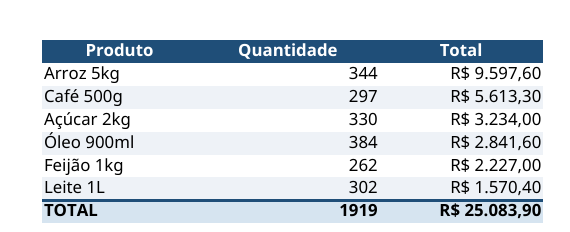

# Consolidador de Planilhas de Vendas

Junta as planilhas de vendas de várias lojas num **único relatório em Excel**, com resumo por loja, resumo por produto e totais, já formatado para entregar.



## O problema

Uma rede com várias lojas recebe, todo mês, uma planilha de vendas de cada loja. Juntar tudo à mão é demorado: copiar e colar, montar tabela dinâmica, formatar valores. E ainda há o risco de esquecer um arquivo ou somar uma linha duas vezes.

## A solução

Basta colocar as planilhas numa pasta e rodar um comando. Em segundos sai um relatório com:

| Aba | Conteúdo |
|---|---|
| **Por Loja** | Faturamento de cada loja, da maior para a menor |
| **Por Produto** | Quantidade vendida e faturamento de cada produto |
| **Todas as Vendas** | Todas as vendas juntas, com a coluna **Loja** e o **Total** de cada venda |

Todas as abas trazem:
- valores em reais (**R$ 8.758,50**) e datas no formato brasileiro (**01/10/2026**);
- linha **TOTAL** que **acompanha o filtro**: se você filtrar uma loja, o total muda junto;
- cabeçalho fixo ao rolar a tela, filtros em cada coluna e linhas zebradas para facilitar a leitura.

Os valores continuam sendo **números de verdade**, não texto. Dá para somar, filtrar e fazer gráfico em cima deles.

## Como usar

1. Coloque as planilhas na pasta `entrada/`, uma por loja, com o nome `vendas_<loja>.xlsx` (por exemplo, `vendas_centro.xlsx`).
2. Cada planilha deve ter as colunas **Data**, **Produto**, **Quantidade** e **Preço Unitário**.
3. Rode:

   ```bash
   python juntar.py
   ```

4. O relatório sai em `saida/relatorio_vendas.xlsx`.

O programa encontra **sozinho** todos os arquivos da pasta. Tanto faz se são 3 lojas ou 30, e não é preciso mudar nada no código quando entra uma loja nova.

## Instalação

Precisa do Python 3.10 ou mais novo.

```bash
python3 -m venv .venv
source .venv/bin/activate        # no Windows: .venv\Scripts\activate
pip install -r requirements.txt
```

## Estrutura

```
consolidador-planilhas/
├── entrada/          planilhas das lojas (exemplos fictícios)
├── saida/            relatório gerado
├── juntar.py         lê, junta e resume os dados
├── formatar.py       aplica a formatação do relatório
└── requirements.txt  bibliotecas necessárias
```

## Decisões do projeto

- **Dinheiro arredondado em 2 casas em todo cálculo.** O computador guarda números decimais de forma aproximada (`0.1 + 0.2` dá `0.30000000000000004`). Para um relatório gerencial, arredondar resolve. Para uso contábil ou fiscal, o certo seria trabalhar com centavos inteiros: isso é combinado com o cliente antes de começar.
- **Dados separados da aparência.** `juntar.py` cuida dos números e `formatar.py` cuida do visual. Trocar cores ou formatos não mexe nos cálculos.
- **Totais conferidos.** O total das três abas tem que ser o mesmo. Se não bater, alguma venda se perdeu.

## Tecnologias

Python, [pandas](https://pandas.pydata.org/) (leitura e resumo dos dados) e [openpyxl](https://openpyxl.readthedocs.io/) (formatação do Excel).

## Sobre

Projeto de portfólio de **Gilmar Alberto de Abreu Pinto**, analista de sistemas em Curitiba. Os dados são fictícios. Desenvolvido com apoio de IA (Claude).

**Precisa de algo parecido com as suas planilhas?** Me contrate pela plataforma que você já usa:

- [99Freelas](https://www.99freelas.com.br/user/GilmarAlberto)
- [Workana](https://www.workana.com/freelancer/1ccbe3135f7ebb6a82b57c41ea77d535)
